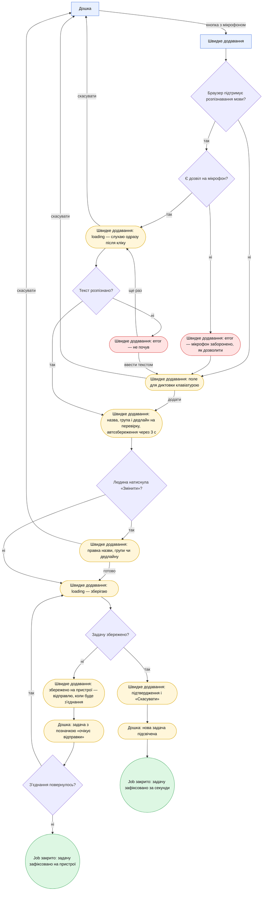
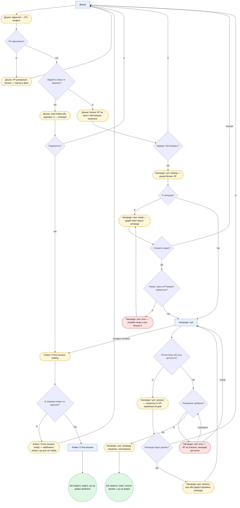
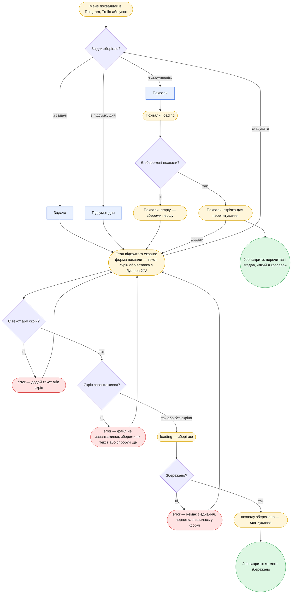

# User flows — CRM-MMMY

Чернетка, 2026-11-10. Виправлено за критикою того ж дня (коди дефектів ТП, СТ, ГЛ, СР вказано біля правок).

Джерела:
- jobs — [JTBD.md](./JTBD.md);
- назви екранів і станів — [sitemap.md](./sitemap.md);
- персона — [personas.md](./personas.md).

**Персона.** Primary з `personas.md` — автор. Обставини:
- ранок за комп'ютером, Trello й Telegram поруч;
- кілька задач на день;
- іноді з телефона в дорозі.

**Легенда вузлів:**

| Вигляд | Що означає |
|---|---|
| `[Екран]` прямокутник | Екран зі sitemap.md |
| `{Питання?}` ромб | Розвилка: дані можуть не прийти, введення хибне або дія не пройшла |
| `(["Екран: стан"])` овал | Стан екрана: empty, error, loading або підтвердження |
| `(("…"))` зелене коло | Job закрито |

**Правило виходу.** Кожен error має щонайменше два виходи: повторити і повернутися назад. Немає жодного циклу повторів без виходу. Тупиків без виходу після виправлень не лишилось (див. «Повторна перевірка» в кінці).

## Чому саме ці related jobs

| Job | Чому обрано |
|---|---|
| **J2 — задача з Telegram без відмітки** | **Найризикованіший.** Тут уже був реальний збій: задачі загубились, і команда просіла по дедлайну. Втрата тиха |
| **J3 — надиктувати задачу голосом** | **Найчастіший** спосіб фіксувати нове. До того ж технічний ризик: Web Speech API може не підтримувати українську (CLAUDE.md §9) |
| **J11 — винагородити себе за досягнуту ціль** | **Ризикований емоційно:** це головна мотивація продукту |
| **J9 — зберегти похвалу** | Доданий за дефектом СР-4. Похвала — найсильніший мотиватор автора, а `praise.html` не був у жодному flow |

J7 («підсумок дня») — частина flow головної роботи.

---

## Main job: бачити всі задачі разом, нічого не загубити, знати з чого почати і закрити день не дарма

```mermaid
flowchart TD
    START(["Ранок: автор відкриває CRM"]) --> Q_SESSION{"Сесія є?"}
    Q_SESSION -->|ні| LOGIN(["Дошка: немає сесії — поле email"])
    LOGIN --> Q_EMAIL{"Email правильний?"}
    Q_EMAIL -->|ні| LOGIN_ERR(["Дошка: error — хибний email"])
    LOGIN_ERR --> LOGIN
    Q_EMAIL -->|так| LOGIN_SENT(["Дошка: лист надіслано — перевір пошту і спам"])
    LOGIN_SENT --> Q_LINK{"Посилання спрацювало?"}
    Q_LINK -->|так| BOARD_LOADING
    Q_LINK -->|ні| LINK_ERR(["Дошка: error — посилання прострочене або лист не прийшов"])
    LINK_ERR -->|надіслати ще раз| LOGIN_SENT
    LINK_ERR -->|інший email| LOGIN
    Q_SESSION -->|так| BOARD_LOADING(["Дошка: loading — синхронізація з Trello і Telegram"])

    BOARD_LOADING --> Q_SYNC{"Дані з джерел прийшли?"}
    Q_SYNC -->|ні| BOARD_SYNC_ERR(["Дошка: error — джерело не відповідає, показано збережені задачі"])
    BOARD_SYNC_ERR --> Q_KEY{"Причина в ключі доступу?"}
    Q_KEY -->|ні, збій сервісу| BOARD
    Q_KEY -->|так| SOURCES["Групи і джерела"]
    SOURCES --> SOURCES_LOADING(["Групи і джерела: loading — підключаю"])
    SOURCES_LOADING --> Q_RECONNECT{"Перепідключення пройшло?"}
    Q_RECONNECT -->|так| BOARD_LOADING
    Q_RECONNECT -->|ні| SOURCES_ERR(["Групи і джерела: error — хибний токен, інструкція"])
    SOURCES_ERR -->|повторити| SOURCES
    SOURCES_ERR -->|пізніше| BOARD_OFF(["Дошка: джерело відключено, решта працює"])
    BOARD_OFF --> BOARD

    Q_SYNC -->|так| Q_EMPTY{"Є хоч одна задача?"}
    Q_EMPTY -->|ні| BOARD_EMPTY(["Дошка: empty — додай задачу або підключи джерело"])
    BOARD_EMPTY -->|додати свою| CAPTURE["Швидке додавання"]
    CAPTURE -->|flow J3| BOARD
    BOARD_EMPTY -->|підключити| SOURCES
    Q_EMPTY -->|так| Q_MOOD{"Настрій на сьогодні вибрано?"}
    Q_MOOD -->|ні| BOARD_MOOD(["Дошка: стан «настрій не вибрано»"])
    BOARD_MOOD --> Q_MOOD_PICK{"Вибрав настрій?"}
    Q_MOOD_PICK -->|ні, пропустив| BOARD_MOOD_SKIP(["Дошка: настрій пропущено — звичайний план"])
    BOARD_MOOD_SKIP --> BOARD
    Q_MOOD_PICK -->|так| Q_MOOD_SAVED{"Настрій збережено?"}
    Q_MOOD_SAVED -->|ні| MOOD_ERR(["Дошка: error — настрій не збережено, тема стандартна"])
    MOOD_ERR -->|повторити| BOARD_MOOD
    MOOD_ERR -->|далі| BOARD
    Q_MOOD_SAVED -->|так| BOARD_PLAN(["Дошка: тема і план під настрій — задачі за розміром, перенесене вчора першим"])
    BOARD_PLAN --> BOARD
    Q_MOOD -->|так| BOARD["Дошка"]

    BOARD --> Q_INBOX{"Є нерозібрані можливі задачі?"}
    Q_INBOX -->|так| Q_INBOX_NOW{"Розібрати зараз?"}
    Q_INBOX_NOW -->|так| INBOX["Можливі задачі"]
    INBOX -->|flow J2| BOARD
    Q_INBOX_NOW -->|пізніше| BOARD_COUNTER(["Дошка: лічильник лишається видимим"])
    BOARD_COUNTER --> BOARD_DRAG
    Q_INBOX -->|ні| BOARD_DRAG(["Дошка: картку перетягнуто в In Progress"])

    BOARD_DRAG --> Q_TRELLO{"Задача з Trello?"}
    Q_TRELLO -->|ні| TASK
    Q_TRELLO -->|так| Q_MOVE{"Статус записано в Trello?"}
    Q_MOVE -->|так| TASK
    Q_MOVE -->|ні| SYNC_PENDING(["Дошка: зміну збережено в CRM, очікує синхронізації"])
    SYNC_PENDING --> TASK

    TASK["Задача"] --> TASK_LOADING(["Задача: loading — матеріали з джерела"])
    TASK_LOADING --> Q_MAT{"Матеріали завантажились?"}
    Q_MAT -->|ні| TASK_MAT_ERR(["Задача: error — вкладення недоступне, є посилання на оригінал"])
    TASK_MAT_ERR --> TASK_TIMER
    Q_MAT -->|так| TASK_TIMER(["Задача: таймер іде — міні-плашка на всіх екранах і час у вкладці"])
    TASK_TIMER --> Q_IDLE{"Неактивність довше 15 хв?"}
    Q_IDLE -->|так| TIMER_PAUSED(["Задача: таймер на паузі — неактивність"])
    TIMER_PAUSED -->|продовжити| TASK_TIMER
    TIMER_PAUSED -->|зупинити| BOARD_REVIEW
    Q_IDLE -->|ні або не визначено| Q_TIMER_LONG{"Таймер іде довше 8 годин?"}
    Q_TIMER_LONG -->|так| TIMER_ERR(["Задача: error — таймер, схоже, забутий, виправ час"])
    TIMER_ERR --> BOARD_REVIEW
    Q_TIMER_LONG -->|ні| BOARD_REVIEW(["Дошка: задача в In Review"])
    BOARD_REVIEW --> Q_APPROVE{"Апрув прийшов?"}
    Q_APPROVE -->|правки| TASK_TIMER
    Q_APPROVE -->|ще ні| BOARD_WAITING(["Дошка: на картці «чекає апрув N днів»"])
    BOARD_WAITING --> BOARD
    Q_APPROVE -->|так| BOARD_APPROVED(["Дошка: Approved — XP і конфеті"])
    BOARD_APPROVED --> BOARD

    BOARD -->|пункт «День», будь-коли| DAY_LOADING(["Підсумок дня: loading — рахую вагу і XP"])
    DAY_LOADING --> Q_DAY_OK{"Підсумок пораховано?"}
    Q_DAY_OK -->|ні| DAY_ERR(["Підсумок дня: error — не вдалося порахувати"])
    DAY_ERR -->|повторити| DAY_LOADING
    DAY_ERR -->|назад| BOARD
    Q_DAY_OK -->|так| Q_DONE{"Сьогодні щось закрито?"}
    Q_DONE -->|ні| DAY_EMPTY(["Підсумок дня: empty — показано час, прохання, похвали і маленьку задачу"])
    DAY_EMPTY --> Q_SMALL{"Взяти маленьку задачу?"}
    Q_SMALL -->|так| BOARD
    Q_SMALL -->|ні| DAY_TOMORROW(["Підсумок дня: план на завтра збережено"])
    DAY_TOMORROW --> OK_SOFT(("Job закрито: день не порожній — видно час, прохання і план"))
    Q_DONE -->|так| DAY["Підсумок дня"]
    DAY --> Q_LEFT{"У плані дня лишились незакриті?"}
    Q_LEFT -->|ні| OK(("Job закрито: усе видно, нічого не загублено, день не дарма"))
    Q_LEFT -->|так| DAY_WRAP(["Підсумок дня: розбір незакритого — на завтра або зняти з плану"])
    DAY_WRAP --> Q_WRAP_SAVED{"Перенесення збережено?"}
    Q_WRAP_SAVED -->|так| OK
    Q_WRAP_SAVED -->|ні| WRAP_ERR(["Підсумок дня: error — перенесення не збережено"])
    WRAP_ERR -->|повторити| DAY_WRAP
    WRAP_ERR -->|пропустити| OK

    classDef screen fill:#E8F0FF,stroke:#3B6FE0,color:#111
    classDef state fill:#FFF6DA,stroke:#D9A400,color:#111
    classDef err fill:#FFE3E3,stroke:#D94141,color:#111
    classDef ok fill:#DDF7E3,stroke:#2E9E4F,color:#111
    class SOURCES,BOARD,INBOX,TASK,DAY,CAPTURE screen
    class START,LOGIN,LOGIN_SENT,BOARD_LOADING,SOURCES_LOADING,BOARD_OFF,BOARD_EMPTY,BOARD_MOOD,BOARD_MOOD_SKIP,BOARD_PLAN,BOARD_COUNTER,BOARD_DRAG,SYNC_PENDING,TASK_LOADING,TASK_TIMER,TIMER_PAUSED,BOARD_REVIEW,BOARD_WAITING,BOARD_APPROVED,DAY_LOADING,DAY_EMPTY,DAY_TOMORROW,DAY_WRAP state
    class LOGIN_ERR,LINK_ERR,BOARD_SYNC_ERR,SOURCES_ERR,MOOD_ERR,TASK_MAT_ERR,TIMER_ERR,DAY_ERR,WRAP_ERR err
    class OK,OK_SOFT ok
```

**Розвилки:**
1. **Сесія є?**
2. **Email правильний?**
3. **Посилання спрацювало?** — ТП-8: тепер є повторне надсилання і зміна email.
4. **Дані з джерел прийшли?**
5. **Причина в ключі доступу?**
6. **Перепідключення пройшло?** — ТП-6: «пізніше» веде на дошку без джерела.
7. **Є хоч одна задача?** — ТП-7: можна додати свою задачу.
8. **Настрій на сьогодні вибрано?** / **Вибрав настрій?** / **Настрій збережено?** — СТ-5.
9. **Є нерозібрані можливі задачі?** / **Розібрати зараз?** — ТП-3: можна відкласти.
10. **Задача з Trello?** — ТП-5.
11. **Статус записано в Trello?** — ТП-4: без нескінченного повтору.
12. **Матеріали завантажились?** — СТ-2.
13. **Неактивність довше 15 хв?** — патерн NotchOwl: таймер стає на паузу сам, автор вирішує «продовжити» чи «зупинити». Поріг 15 хв — припущення [?]; як визначати неактивність у браузері, ще не перевірено.
    - **Таймер іде довше 8 годин?** — СТ-3. Страховка, якщо неактивність не вдалося визначити. Поріг 8 годин — моє припущення [?].
14. **Апрув прийшов?** — ТП-9: «ще ні» повертає на дошку з позначкою.
15. **Підсумок пораховано?** — СТ-4.
16. **Сьогодні щось закрито?** / **Взяти маленьку задачу?** — ТП-10.
17. **У плані дня лишились незакриті?** / **Перенесення збережено?** — патерн NotchOwl (Wrap up): незакрите не лишається «хвостом провини», а йде в план на завтра або знімається з плану.

**Стани:**

| Тип | Стан |
|---|---|
| loading | «Дошка: синхронізація»; «Групи і джерела: підключаю»; «Задача: матеріали з джерела»; «Підсумок дня: рахую вагу і XP» |
| empty | «Дошка: додай задачу або підключи джерело»; «Підсумок дня: показано час, прохання, похвали і маленьку задачу» |
| error | «Дошка: хибний email»; «Дошка: посилання прострочене»; «Дошка: джерело не відповідає»; «Групи і джерела: хибний токен»; «Дошка: настрій не збережено»; «Задача: вкладення недоступне»; «Задача: таймер забутий»; «Підсумок дня: не вдалося порахувати»; «Підсумок дня: перенесення не збережено» |
| Інші | «Дошка: лист надіслано»; «джерело відключено»; «настрій не вибрано»; «настрій пропущено»; «план під настрій»; «лічильник видимий»; «картку перетягнуто» (ГЛ-3); «очікує синхронізації»; «Задача: таймер іде» з міні-плашкою; «Задача: таймер на паузі — неактивність»; «Дошка: In Review»; «чекає апрув N днів»; «Approved — XP і конфеті»; «Підсумок дня: план на завтра»; «Підсумок дня: розбір незакритого» |

**Кінці:**
- **Успіх 1:** усе видно, нічого не загублено, день не дарма.
- **Успіх 2 («мʼякий»):** закритих задач немає, але день не порожній — видно час, прохання і план.

**Тупиків немає.**

**Глибина (ГЛ-4):** «Підсумок дня» досяжний з дошки одним кліком у будь-який момент, як і обіцяє розділ «Навігація».

---

## J2: задача з Telegram без відмітки гарантовано потрапляє в мій список

```mermaid
flowchart TD
    START(["У робочому чаті Telegram пишуть задачу"]) --> Q_BOT{"Бот у чаті і бачить усі повідомлення?"}
    Q_BOT -->|ні| BOARD_BOT_WARN(["Дошка: попередження — бот не бачить чат, повідомлення можуть губитись"])
    BOARD_BOT_WARN --> SOURCES["Групи і джерела"]
    SOURCES --> SOURCES_LOADING(["Групи і джерела: loading — перевіряю бота"])
    SOURCES_LOADING --> Q_BOT_FIX{"Бот знову бачить чат?"}
    Q_BOT_FIX -->|ні| SOURCES_ERR(["Групи і джерела: error — інструкція: додати бота, вимкнути privacy mode"])
    SOURCES_ERR -->|повторити| SOURCES
    SOURCES_ERR -->|пізніше| BOARD_BOT_WARN
    Q_BOT_FIX -->|так| SOURCES_OK(["Групи і джерела: бот працює — пропущене за період перешли боту вручну"])
    SOURCES_OK --> BOARD

    Q_BOT -->|так| Q_MENTION{"Є відмітка автора або відповідь на його повідомлення?"}
    Q_MENTION -->|так| BOARD_NEW(["Дошка: нова задача з Telegram"])
    BOARD_NEW --> OK_AUTO(("Job закрито: задача на дошці автоматично"))
    Q_MENTION -->|ні| BOARD["Дошка"]

    BOARD --> BOARD_COUNTER(["Дошка: лічильник можливих задач +1"])
    BOARD_COUNTER --> Q_OPEN{"Автор відкрив Можливі задачі?"}
    Q_OPEN -->|ні| BOARD_NUDGE(["Дошка: акцент на лічильнику — повідомлення чекає понад 4 години"])
    BOARD_NUDGE --> Q_OPEN
    Q_OPEN -->|так| INBOX_LOADING(["Можливі задачі: loading"])
    INBOX_LOADING --> Q_LOADED{"Повідомлення завантажились?"}
    Q_LOADED -->|ні| INBOX_ERR(["Можливі задачі: error — не вдалося завантажити"])
    INBOX_ERR -->|повторити| INBOX_LOADING
    INBOX_ERR -->|назад| BOARD
    Q_LOADED -->|так| Q_ANY{"Є нерозібрані?"}
    Q_ANY -->|ні| INBOX_EMPTY(["Можливі задачі: empty — усе розібрано"])
    INBOX_EMPTY --> OK_CLEAN(("Job закрито: нічого не загублено"))
    Q_ANY -->|так| INBOX["Можливі задачі"]

    INBOX --> Q_DUP{"Вже є на дошці?"}
    Q_DUP -->|так| INBOX_DUP(["Можливі задачі: вже є на дошці — посилання на задачу"])
    INBOX_DUP --> Q_ANY
    Q_DUP -->|ні| Q_IS_TASK{"Це задача?"}
    Q_IS_TASK -->|ні| INBOX_REJECTED(["Можливі задачі: відхилено — «Скасувати» і фільтр «Відхилені»"])
    INBOX_REJECTED --> Q_UNDO{"Відхилено помилково?"}
    Q_UNDO -->|так| INBOX
    Q_UNDO -->|ні| Q_ANY
    Q_IS_TASK -->|так| Q_TEXT{"Є текст для назви?"}
    Q_TEXT -->|ні, лише медіа| INBOX_TITLE(["Можливі задачі: введи назву"])
    INBOX_TITLE --> INBOX_CONVERT
    Q_TEXT -->|так| INBOX_CONVERT(["Можливі задачі: перетворення на місці — розмір M за замовчуванням"])
    INBOX_CONVERT --> Q_SAVED{"Збережено?"}
    Q_SAVED -->|ні| CONVERT_ERR(["Можливі задачі: error — немає зʼєднання, повідомлення лишилось новим"])
    CONVERT_ERR -->|повторити| INBOX_CONVERT
    CONVERT_ERR -->|пізніше| Q_ANY
    Q_SAVED -->|так| INBOX_CONVERTED(["Можливі задачі: перетворено — задача на дошці"])
    INBOX_CONVERTED --> Q_ANY

    classDef screen fill:#E8F0FF,stroke:#3B6FE0,color:#111
    classDef state fill:#FFF6DA,stroke:#D9A400,color:#111
    classDef err fill:#FFE3E3,stroke:#D94141,color:#111
    classDef ok fill:#DDF7E3,stroke:#2E9E4F,color:#111
    class BOARD,INBOX,SOURCES screen
    class START,BOARD_BOT_WARN,SOURCES_LOADING,SOURCES_OK,BOARD_NEW,BOARD_COUNTER,BOARD_NUDGE,INBOX_LOADING,INBOX_EMPTY,INBOX_DUP,INBOX_REJECTED,INBOX_TITLE,INBOX_CONVERT,INBOX_CONVERTED state
    class SOURCES_ERR,INBOX_ERR,CONVERT_ERR err
    class OK_AUTO,OK_CLEAN ok
```

**Розвилки:**
1. **Бот у чаті і бачить усі повідомлення?** — ТП-1. Тиха втрата стала видимою: попередження на дошці.
2. **Бот знову бачить чат?**
3. **Є відмітка або відповідь?**
4. **Автор відкрив Можливі задачі?** — ТП-13: нагадування-акцент через 4 години. Поріг — моє припущення [?].
5. **Повідомлення завантажились?** — ТП-11: є вихід «назад».
6. **Є нерозібрані?**
7. **Вже є на дошці?** — СТ-10.
8. **Це задача?**
9. **Відхилено помилково?** — ТП-2.
10. **Є текст для назви?**
11. **Збережено?** — ТП-12.

**Стани:**

| Тип | Стан |
|---|---|
| loading | «Групи і джерела: перевіряю бота»; «Можливі задачі: loading» |
| empty | «Можливі задачі: усе розібрано» |
| error | «Групи і джерела: інструкція — додати бота»; «Можливі задачі: не вдалося завантажити»; «Можливі задачі: немає зʼєднання» |
| Інші | «Дошка: бот не бачить чат»; «Групи і джерела: бот працює — перешли пропущене»; «Дошка: нова задача»; «лічильник +1»; «акцент на лічильнику»; «Можливі задачі: вже є на дошці»; «відхилено — Скасувати»; «введи назву»; «перетворення на місці»; «перетворено» |

**Кінці:**
- **Успіх 1:** задача автоматично з'явилась на дошці.
- **Успіх 2:** усе розібрано, нічого не загублено.

**Тупиків немає.** Обмеження: Bot API не читає історію чату, тому повідомлення, пропущені, поки бот не працював, треба переслати боту вручну. Стан про це повідомляє.

**Глибина (ГЛ-1):** лічильник → «Це задача» = **2 кліки**. Перетворення відбувається на місці, розмір M стоїть за замовчуванням. Окремий екран «Задача» не потрібен.

---

## J3: надиктувати задачу голосом прямо в CRM

**Розвилки:**
1. **Браузер підтримує розпізнавання мови?** — якщо ні, людина диктує клавіатурою (CLAUDE.md §5, п. 6).
2. **Є дозвіл на мікрофон?**
3. **Текст розпізнано?**
4. **Людина натиснула «Змінити»?** — СТ-7: розпізнані назву, групу й дедлайн видно до збереження, а хибно розпізнаний дедлайн можна виправити. Без розпізнаної групи підставляється «Особисте».
5. **Задачу збережено?** — ТП-15.
6. **Зʼєднання повернулось?**

«Скасувати» доступне зі станів «слухаю», «поле для диктовки» і «правка» (ТП-14).

**Стани:**

| Тип | Стан |
|---|---|
| loading | «Швидке додавання: слухаю»; «Швидке додавання: зберігаю» (СТ-8) |
| empty | «Поле для диктовки клавіатурою»: порожнє поле, коли розпізнавання недоступне |
| error | «Мікрофон заборонено»; «Не почув» |
| Інші | «Назва, група і дедлайн на перевірку»; «Правка»; «Збережено на пристрої»; «Дошка: очікує відправки»; «Підтвердження і Скасувати»; «Дошка: нова задача підсвічена» |

**Кінці:**
- **Успіх 1:** задачу зафіксовано й видно на дошці.
- **Успіх 2:** без зʼєднання задачу зафіксовано на пристрої, і вона відправиться пізніше.

**Тупиків немає.**

**Глибина (ГЛ-2):** **1 клік.** Мікрофон слухає одразу після натискання кнопки, а збереження відбувається автоматично через 3 с. Поріг 3 с — моє припущення [?]. Дозвіл на мікрофон браузер питає лише перший раз.

---

## J11: винагородити себе за досягнуту ціль

**Розвилки:**
1. **XP нараховано?** — ТП-16: донарахування у фоні, flow не блокується.
2. **Відкрито ачівку чи відзнаку?** / **Подивитися?** — отримання ачівки стало станом дошки, де сталася дія.
3. **Відкрив «Мотивацію»?** — flow більше не веде в «Мотивацію» силоміць після кожного апруву.
4. **Є нагороди?** / **Створити зараз?** — ТП-17: можна відкласти.
5. **Назва і ціна введені правильно?**
6. **Є отримані ачівки чи відзнаки?** — СТ-9.
7. **XP вистачає або ціль досягнута?**
8. **Нагорода надто далеко?** — ТП-19. Оцінює людина, а CRM показує приблизну кількість днів.
9. **Отримання пройшло?** — ТП-18.

**Стани:**

| Тип | Стан |
|---|---|
| loading | «Нагороди і цілі: рахую баланс XP»; «Ачівки і Стіна пошани: loading» |
| empty | «Нагороди і цілі: додай першу нагороду»; «Ачівки і Стіна пошани: найближча ачівка» |
| error | «Потрібні назва і ціна»; «XP не списано» |
| Інші | «Дошка: Approved — XP і конфеті»; «XP донарахую пізніше»; «нова ачівка +1»; «баланс XP оновлено»; «прогрес — лишилось N XP»; «змінити ціну»; «нагороду отримано» |

**Кінці:**
- **Успіх 1:** нагороду отримано.
- **Успіх 2:** видно, що зроблене — добре: ачівки й відзнаки.

**Тупиків немає.**

---

## J9: зберегти похвалу і відсвяткувати момент

Форма похвали — це стан того екрана, з якого її відкрили, а не окремий екран.

**Розвилки:**
1. **Звідки зберігаю?**
2. **Є збережені похвали?**
3. **Є текст або скрін?** — хибне введення.
4. **Скрін завантажився?** — стосується і скріна, вставленого з буфера (патерн NotchOwl «Clips»).
5. **Збережено?**

«Скасувати» з форми повертає назад.

**Стани:**

| Тип | Стан |
|---|---|
| loading | «Похвали: loading»; «зберігаю» |
| empty | «Похвали: збережи першу» |
| error | «Додай текст або скрін»; «Файл не завантажився»; «Немає зʼєднання» |
| Інші | «Форма похвали» (текст, скрін або вставка з буфера); «Стрічка для перечитування»; «Похвалу збережено — святкування» |

Стани без назви екрана належать тому екрану, де відкрито форму.

**Кінці:**
- **Успіх 1:** похвалу збережено.
- **Успіх 2:** перечитав збережені.

**Тупиків немає.**

---

## Повторна перевірка після виправлень

| Перевірка | Результат |
|---|---|
| **Тупики** | **0 у п'яти flows.** Кожен error має «повторити» і «назад» або «пізніше». Цикли без виходу прибрано: ТП-4, 8, 11, 12, 16, 17, 18. Тупикові кінці замінено виходами: ТП-1, 2, 3, 5, 6, 7, 9, 10, 13, 14, 15, 19 |
| **Відсутні стани** | Кожен екран-вузол тепер має loading, error і, де можливі порожні дані, empty. Залишки — у таблиці «Стани екранів» у sitemap.md: там описано й екрани без flow (`theme.html`, ручний запис часу в `task.html`) |
| **Сироти** | Див. sitemap.md, «Трасування»: порожніх рядків і колонок немає. Усі вузли-екрани flows є в реєстрі; нових екранів правки не вимагали |
| **Глибина** | Main job — 0 кліків; J2 — 2 (ГЛ-1); J3 — 1 (ГЛ-2); підсумок дня — 1 (ГЛ-4); статус — перетягування на дошці (ГЛ-3) |
| **Патерни NotchOwl** (2026-11-10) | Нові розвилки «Неактивність?» і «Перенесення збережено?» мають виходи: пауза → продовжити / зупинити; error → повторити / пропустити. Нових екранів немає |
| **Mermaid** | П'ять діаграм перевірено рендером Mermaid 11 |
